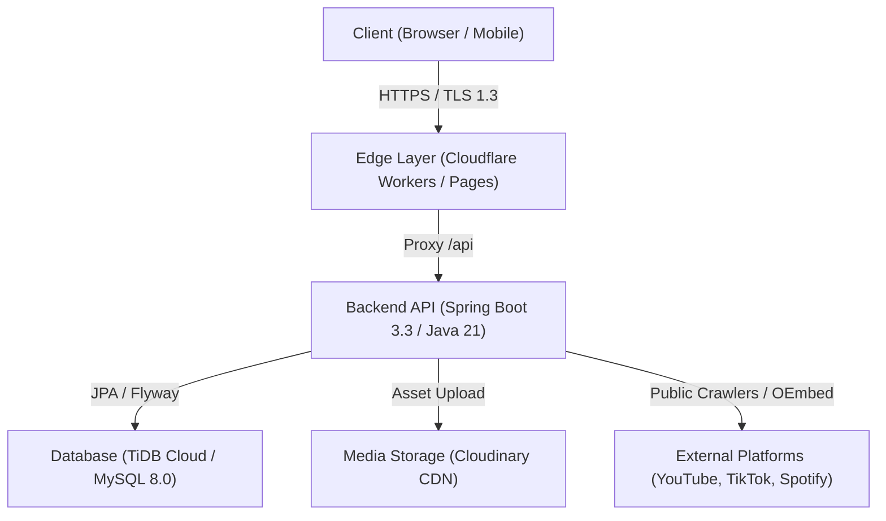

# MELODICK RECS.

<div align="center">

[](https://spring.io/projects/spring-boot)
[](https://openjdk.org/)
[](https://react.dev/)
[](https://www.typescriptlang.org/)
[](https://vitejs.dev/)
[](https://www.mysql.com/)
[](LICENSE)

**Architects of the underground sound.**  
A high-performance, dark-minimalist record label platform and content management system designed for underground electronic music culture.

[Live Demo](https://melodickrecs.melodickrecs.workers.dev) • [Report Bug](https://github.com/nguyenthanhbinh888/MELODICK_LANDING/issues) • [Request Feature](https://github.com/nguyenthanhbinh888/MELODICK_LANDING/issues)

</div>

---

## 📑 Table of Contents

- [Overview](#-overview)
- [Key Features](#-key-features)
- [Architecture & Tech Stack](#-architecture--tech-stack)
- [Project Structure](#-project-structure)
- [Getting Started](#-getting-started)
  - [Prerequisites](#prerequisites)
  - [Backend Setup](#backend-setup)
  - [Frontend Setup](#frontend-setup)
- [Environment Configuration](#-environment-configuration)
- [Multi-Platform Metric Engine](#-multi-platform-metric-engine)
- [API Reference](#-api-reference)
- [Security & Compliance](#-security--compliance)
- [Production Deployment](#-production-deployment)
- [Contributing](#-contributing)
- [License](#-license)

---

## 🌟 Overview

**MELODICK RECS.** is an all-in-one digital presence and CMS engineered for independent music record labels. It features an atmospheric, dark-minimalist landing page that showcases exclusive artists alongside real-time metrics across major streaming and social platforms, backed by a secure management portal.

The application is built on a decoupled architecture:
- **Client:** Fast, responsive Single Page Application (SPA) leveraging React 19, TypeScript, and Vite.
- **API Services:** Robust REST API powered by Java 21, Spring Boot 3.3, Spring Security, and Flyway database migrations.
- **Data Layer:** Cloud-native TiDB / MySQL 8.0 with automatic migration self-healing.

---

## ✨ Key Features

### 🎧 Public Experience (`/`, `/artists`, `/submit`)
- **Atmospheric Dark/Underground Design:** Signature deep-black typography, Montserrat font pairing, and interactive liquid glow trailing user interactions.
- **Dynamic Artist Roster:** Real-time data hydration with lazy-loaded media and responsive glassmorphism artist cards.
- **Multi-Platform Metric Badges:** Automatically presents verified platform metrics (YouTube top video views, TikTok followers, and Spotify listeners/discography stream averages) alongside branded vector icons.
- **Adaptive Social Overlay:** Floating action buttons dynamically display linked platforms (YouTube, Spotify, TikTok, SoundCloud, Instagram) without broken placeholders or empty links.
- **Integrated Demo Submission:** Dynamic demo routing configured directly from the admin panel.

### 🛡️ Admin CMS (`/admin/*`)
- **Restricted Access:** Administrative interface completely isolated from public views, secured with Spring Security, stateless JWT tokens, and BCrypt password encryption.
- **Live Metrics Synchronization:** On-demand and scheduled background crawlers to refresh artist metrics from public endpoints with intelligent caching.
- **Roster & Media Management:** Full CRUD operations for artist profiles, display order reordering, visibility toggles, and seamless image uploads via Cloudinary or local storage.
- **Dynamic Site Settings:** Configure brand taglines, hero banners, Google Forms submission endpoints, and footer social links without redeployment.

---

## 🏗 Architecture & Tech Stack



### Technology Matrix

| Domain | Technology | Description |
|---|---|---|
| **Frontend** | React 19, TypeScript 5.6 | Component-driven user interface with strict type safety |
| **Tooling & Bundler** | Vite 6 | Lightning-fast HMR and optimized production bundling |
| **Routing** | React Router v7 | Declarative client-side routing with route guards |
| **Backend** | Java 21 (LTS), Spring Boot 3.3.5 | High-throughput, enterprise-grade REST API backend |
| **Security** | Spring Security 6, JJWT 0.12.6 | Stateless JWT authentication and BCrypt password hashing |
| **ORM & Migrations** | Spring Data JPA, Hibernate, Flyway | Type-safe persistence and self-healing schema versioning |
| **Database** | MySQL 8.0 / TiDB Cloud Serverless | Distributed ACID-compliant relational storage over TLS |
| **Media Hosting** | Cloudinary SDK | Cloud image optimization, transformations, and global CDN |
| **Hosting & Edge** | Cloudflare Workers & Render | Edge routing, global CDN caching, and managed containers |

---

## 📁 Project Structure

```text
MELODICK_LANDING/
├── frontend/                     # React Single Page Application
│   ├── src/
│   │   ├── app/                  # Application routing & context providers
│   │   ├── components/           # Reusable UI & layout components
│   │   │   ├── admin/            # CMS Dashboard & management modals
│   │   │   ├── common/           # Shared UI (LiquidCursor, Badges, Logos)
│   │   │   └── public/           # Public navigation, hero, and artist cards
│   │   ├── layouts/              # PublicLayout and AdminLayout wrappers
│   │   ├── pages/                # Page route views
│   │   ├── services/             # Axios/Fetch API client layer
│   │   ├── types/                # TypeScript interfaces and contracts
│   │   └── utils/                # Metric formatters and platform helpers
│   ├── .env.example              # Frontend environment variables template
│   └── package.json
│
├── backend/                      # Spring Boot REST API Application
│   ├── src/main/java/com/melodick/recs/
│   │   ├── config/               # Security, CORS, Cloudinary, and Flyway configs
│   │   ├── controller/           # REST endpoints (Public, Auth, Admin)
│   │   ├── dto/                  # Data Transfer Objects & validation schemas
│   │   ├── entity/               # JPA Entities (Artist, AdminUser, SiteSetting)
│   │   ├── exception/            # Centralized API exception handling
│   │   ├── repository/           # Spring Data JPA repositories
│   │   ├── security/             # JWT token filters, providers, and entry points
│   │   └── service/              # Core business logic and multi-platform scrapers
│   ├── src/main/resources/
│   │   ├── db/migration/         # Flyway version-controlled SQL migrations
│   │   └── application.yml       # Production-ready configuration profile
│   ├── .env.example              # Backend environment variables template
│   └── pom.xml
│
├── .gitignore                    # Comprehensive ignore rules (Node, Maven, Secrets)
└── README.md                     # Project documentation
```

---

## 🚀 Getting Started

### Prerequisites

Ensure the following runtimes and tools are installed locally:
- **Node.js:** v18.0.0 or higher (v20+ recommended)
- **Java Development Kit (JDK):** Version 21 LTS
- **Apache Maven:** 3.9+
- **MySQL Server:** 8.0+ (or access to a remote TiDB/MySQL instance)

---

### Backend Setup

1. **Navigate to the backend directory:**
   ```bash
   cd backend
   ```

2. **Configure environment variables:**
   Copy the example template to create your local `.env`:
   ```bash
   cp .env.example .env
   ```
   Edit `.env` with your local database credentials and a secure random JWT secret.

3. **Prepare the database:**
   Create a dedicated MySQL database:
   ```sql
   CREATE DATABASE IF NOT EXISTS melodick_db 
     CHARACTER SET utf8mb4 
     COLLATE utf8mb4_unicode_ci;
   ```

4. **Build and run automated tests:**
   ```bash
   mvn clean test
   ```

5. **Start the backend server:**
   ```bash
   mvn spring-boot:run
   ```
   *Flyway will automatically execute database migrations (`V1` through `V4`) to initialize schema and default settings.*

---

### Frontend Setup

1. **Navigate to the frontend directory:**
   ```bash
   cd frontend
   ```

2. **Install project dependencies:**
   ```bash
   npm install
   ```

3. **Configure environment variables:**
   Copy the sample environment file:
   ```bash
   cp .env.example .env
   ```
   *For local development, leave `VITE_API_BASE_URL` empty to utilize the Vite development proxy (`/api` -> `http://localhost:8080`).*

4. **Launch the development server:**
   ```bash
   npm run dev
   ```
   Open [http://localhost:5173](http://localhost:5173) in your browser.

---

## 🔐 Environment Configuration

> [!IMPORTANT]
> Never commit actual passwords, API tokens, or secrets to the repository. All secrets must be injected through environment variables or secure deployment vaults.

### Backend (`backend/.env.example`)

```dotenv
# Server Configuration
PORT=8080

# Database Configuration (MySQL / TiDB)
SPRING_DATASOURCE_URL=jdbc:mysql://localhost:3306/melodick_db?useSSL=false&allowPublicKeyRetrieval=true&serverTimezone=UTC&characterEncoding=UTF-8
SPRING_DATASOURCE_USERNAME=your_db_username
SPRING_DATASOURCE_PASSWORD=your_db_password
HIKARI_MAX_POOL_SIZE=5

# Admin Bootstrap (Used only for first-time account initialization)
ADMIN_USERNAME=your_admin_username
ADMIN_PASSWORD=your_strong_admin_password

# JWT Security
JWT_SECRET=your_jwt_secret_key_at_least_256_bits_length_here
JWT_EXPIRATION_MS=86400000

# CORS Allowed Origins
CORS_ALLOWED_ORIGINS=http://localhost:5173,http://localhost:3000
FRONTEND_ORIGIN=https://your-domain.com

# Cloudinary Cloud Storage (Optional)
CLOUDINARY_CLOUD_NAME=your_cloud_name
CLOUDINARY_API_KEY=your_api_key
CLOUDINARY_API_SECRET=your_api_secret

# Platform APIs (Optional - Public scrapers are used as automatic fallbacks)
YOUTUBE_API_KEY=
SPOTIFY_CLIENT_ID=
SPOTIFY_CLIENT_SECRET=
STATS_CACHE_TTL_MINUTES=120
```

### Frontend (`frontend/.env.example`)

```dotenv
# Public API Base URL (Leave blank in development to use Vite proxy)
VITE_API_BASE_URL=
```

---

## 📊 Multi-Platform Metric Engine

MELODICK RECS. features an autonomous, resilient multi-platform scraper engine that extracts genuine public metrics without requiring paid API tiers:

| Platform | Metric Extracted | Technique & Fallback Mechanism |
|---|---|---|
| **YouTube** | **Top Video View Count** | Scrapes channel RSS feeds & video oEmbed endpoints to identify the highest-viewed release; optionally integrates with YouTube Data API v3 if a key is provided. |
| **TikTok** | **Follower Count** | Utilizes SSR mobile crawler headers to parse the `__UNIVERSAL_DATA_FOR_REHYDRATION__` payload, bypassing aggressive client-side bot detection. |
| **Spotify** | **Monthly Listeners / Discography Average** | Crawls public Open Graph metadata and artist SSR payloads using search-crawler User-Agents (`Googlebot/2.1`), calculating average streams across public releases. |

All metrics are cached in the relational database with configurable TTL (`STATS_CACHE_TTL_MINUTES`) to respect platform rate limits and guarantee sub-50ms API response times.

---

## 📡 API Reference

### Public Endpoints (Unauthenticated)

| Method | Endpoint | Description |
|---|---|---|
| `GET` | `/api/public/site` | Retrieve public label branding, hero content, submit URL, and social links. |
| `GET` | `/api/public/artists` | Retrieve all published artists, platform badges, and streaming links. |
| `GET` | `/api/health` | Service health check and uptime probe. |

### Authentication

| Method | Endpoint | Description |
|---|---|---|
| `POST` | `/api/admin/auth/login` | Authenticate credentials; returns signed Bearer JWT token. |
| `POST` | `/api/admin/auth/logout` | Invalidate client session. |
| `GET` | `/api/admin/auth/me` | Fetch identity of currently authenticated administrator. |

### Admin Endpoints (`Authorization: Bearer <token>`)

| Method | Endpoint | Description |
|---|---|---|
| `GET` | `/api/admin/dashboard` | Fetch overview statistics (total, published, hidden artists). |
| `GET` | `/api/admin/artists` | List all artists with search filter (`?search=`). |
| `POST` | `/api/admin/artists` | Create a new artist profile with initial platform links. |
| `GET` | `/api/admin/artists/{id}` | Retrieve detailed artist profile by ID. |
| `PUT` | `/api/admin/artists/{id}` | Update artist biography, artwork, and platform URLs. |
| `PATCH` | `/api/admin/artists/{id}/visibility` | Toggle artist visibility (Published / Hidden). |
| `DELETE` | `/api/admin/artists/{id}` | Delete artist profile and cascade child links. |
| `PUT` | `/api/admin/artists/reorder` | Update display order across artist catalog. |
| `POST` | `/api/admin/artists/{id}/refresh-stats` | Force on-demand refresh of artist platform metrics. |
| `GET` | `/api/admin/site-settings` | Fetch CMS editable site settings. |
| `PUT` | `/api/admin/site-settings` | Persist CMS site settings. |
| `POST` | `/api/admin/upload/image` | Upload image file (Cloudinary CDN / local fallback). |

---

## 🔒 Security & Compliance

This repository adheres to standard security hardening principles:
- **No Hardcoded Credentials:** Default credentials and production secrets are strictly forbidden in source code. All configuration is externalized via environment variables.
- **Password Hashing:** Passwords are encrypted using BCrypt with secure salt generation before storage.
- **Stateless Authentication:** JWT tokens are signed using HMAC-SHA256 (minimum 256-bit key) and stored on the client side in `sessionStorage` to mitigate persistent XSS attack vectors.
- **CORS Hardening:** Cross-Origin Resource Sharing is restricted strictly to designated origins defined in `CORS_ALLOWED_ORIGINS`.
- **Database Self-Healing:** Flyway migrations run with automated checksum repair mechanisms to prevent deployment lockouts while maintaining schema consistency.
- **Repository Hygiene:** All sensitive build artifacts, configuration files, and private implementation notes are strictly ignored via `.gitignore`.

---

## 🚢 Production Deployment

### Frontend (Cloudflare Workers / Pages)
The client application is built into a static bundle and served globally via Cloudflare Edge:
```bash
cd frontend
npm run build
# Deploy dist/ via Cloudflare Pages or Wrangler
```

### Backend (Render / Docker / VPS)
The Spring Boot backend can be run directly or containerized. Environment variables must be configured in the hosting provider's dashboard:
- Set `PORT` to the provider-assigned port.
- Configure `SPRING_DATASOURCE_URL`, `SPRING_DATASOURCE_USERNAME`, `SPRING_DATASOURCE_PASSWORD` (use TLS connection for cloud databases like TiDB).
- Provide strong random strings for `JWT_SECRET`, `ADMIN_USERNAME`, and `ADMIN_PASSWORD`.

---

## 🤝 Contributing

Contributions are welcome! Please follow these steps:

1. Fork the repository.
2. Create your feature branch (`git checkout -b feature/amazing-feature`).
3. Commit your changes following [Conventional Commits](https://www.conventionalcommits.org/):
   ```bash
   git commit -m "feat(artists): add soundcloud streaming integration"
   ```
4. Push to your branch (`git push origin feature/amazing-feature`).
5. Open a Pull Request against `develop`.

---

## 📄 License

Distributed under the **MIT License**. See `LICENSE` for more information.

---

<div align="center">
  <sub>Built with passion for underground electronic music. © 2026 MELODICK RECS. All rights reserved.</sub>
</div>
